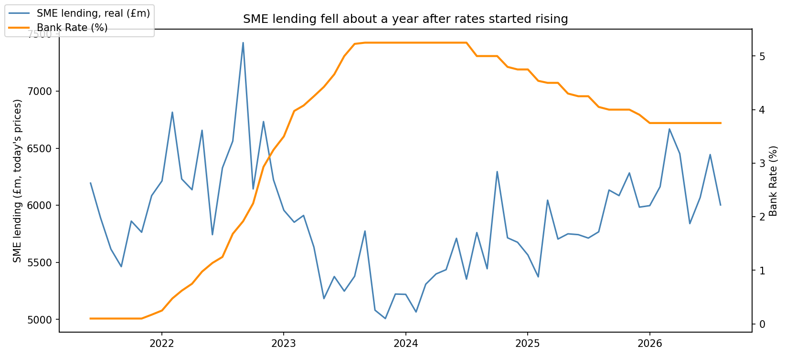
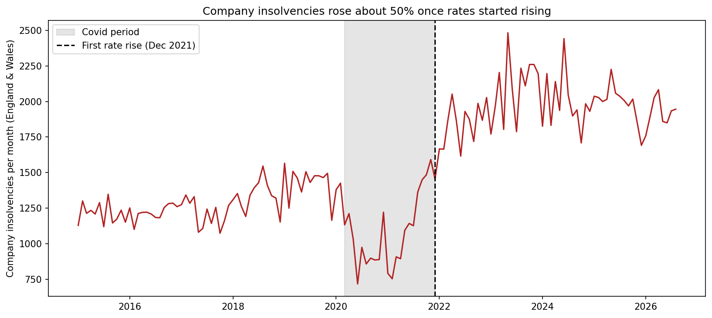
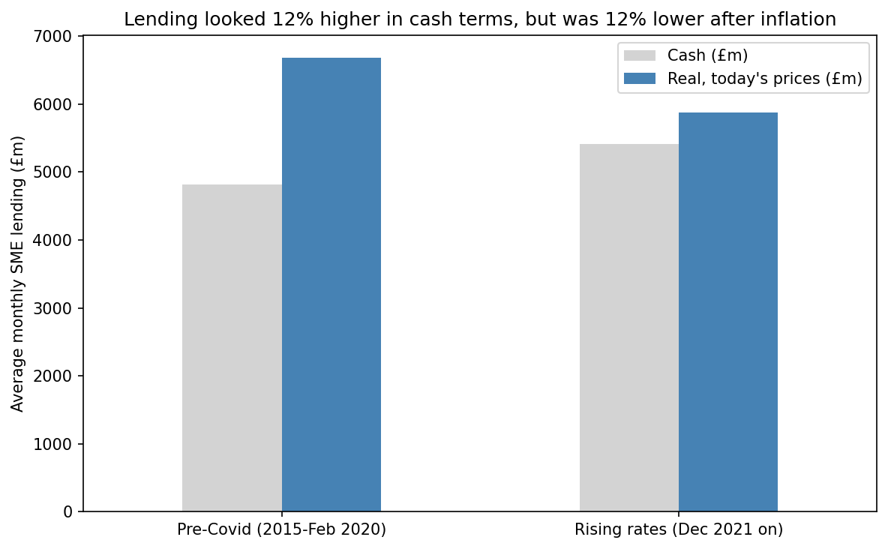

# How UK Rate Rises Hit Small Business Borrowing (2015–2026)

## Question
When the Bank of England raised interest rates from December 2021, did small businesses (SMEs) borrow less, and did more companies fail?

## Key findings
1. **Lending fell, but with a delay.** SME lending kept rising through 2022 and only turned down once Bank Rate passed about 3%. It hit its low in late 2023, roughly a year after the first rise, and recovered from 2024 as rates were cut.
2. **Inflation hid the fall.** In cash terms, average monthly lending looked 12% higher during rising rates than pre-Covid. Adjusted for inflation, it was 12% lower (£5.9bn against £6.7bn in today's prices).
3. **Insolvencies rose about 50%.** Monthly company insolvencies averaged about 1,960 during rising rates against 1,290 pre-Covid. Part of this was a catch-up after Covid-era protections ended.

## What this means
Rate rises reach small businesses slowly. Lenders and policymakers should expect a 9–12 month lag before SME borrowing reacts, and watch for a sharper effect once rates pass around 3%. Cash figures alone can mislead: always adjust for inflation before drawing conclusions.

## Data
- Bank of England Database: SME gross lending (ZM8B) and Bank Rate
- Insolvency Service: company insolvency statistics, England and Wales, seasonally adjusted
- ONS: Consumer Price Index (D7BT)

## Method
Python (pandas, matplotlib) in Google Colab. Monthly data merged on date, split into pre-Covid, Covid and rising-rate periods, compared by period average, visualised over time, adjusted for inflation, and tested for lagged correlation.

## Limitations
- Correlation is not causation; other factors (energy costs, post-Covid recovery) also affected borrowing.
- A simple lag correlation didn't capture the effect, because the relationship changed over time. The delay is based on the visual trend.
- Covid distorts 2020–21: Bounce Back Loans inflated lending, and temporary rules held insolvencies down.
- Lending data covers the UK; insolvency data covers England and Wales only.
- Gross lending only; repayments are not included.
